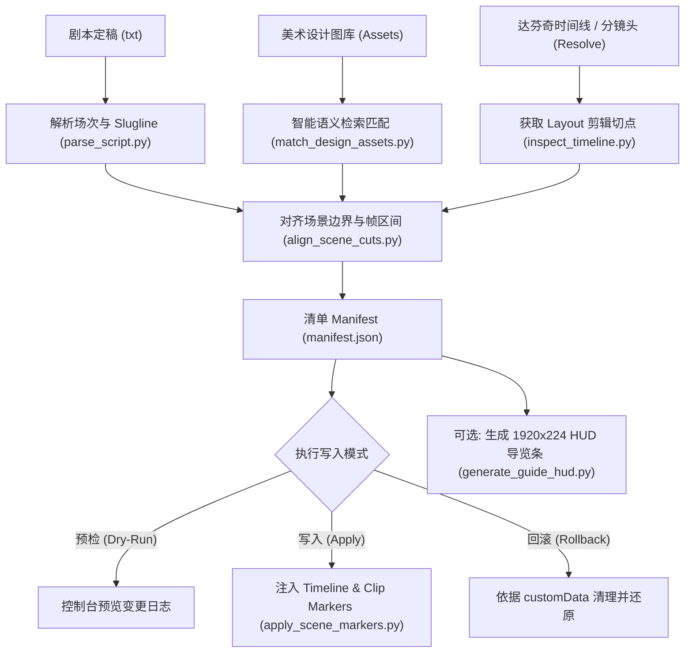

# 达芬奇剧本分镜场景智能标记 (Resolve Script Scene Marker)

## 概述 (Overview)
本技能专为动画、影视与全流程 CG 制作设计。通过打通 **剧本文本定稿**、**场景设计图库**、**分镜头剪辑 (Layout / StoryBook)** 与 **DaVinci Resolve 工程时间线**，实现场景边界自动切分、美术资产智能匹配、时间线范围标记（Timeline Range Markers）、剪辑片段标记（Clip Markers）的自动注入，以及高阶底部 HUD 导览卡片条的生成与上轨。

当用户提出以下需求时，应自动激活本技能：
- “查看/分析达芬奇时间线上的第X集”
- “根据剧本和设计图在达芬奇时间线上打标记”
- “将分镜镜头与剧本场次对齐并标注场景信息”
- “批量给达芬奇时间线添加 Slugline 场景标记或导览卡片”

---

## 核心工作流 (Standard Workflow)



---

## 工具脚本库 (Script Tools)

所有内置脚本均位于 `scripts/` 目录下，可由 Python 独立运行或在 DaVinci Resolve 环境中运行：

### 1. 时间线状态巡检 (`inspect_timeline.py`)
- **功能**：提取当前工程与时间线的轨道信息、分镜头剪辑列表、已有标记统计，支持按时间码导出单帧静帧图片。
- **命令示例**：
  ```powershell
  python skills\resolve-script-scene-marker\scripts\inspect_timeline.py --output-json "output\timeline_status.json"
  ```

### 2. 剧本场次解析 (`parse_script.py`)
- **功能**：解析剧本文本中的场次编号、内外景、场景名、昼夜光照时段、一句话剧情与关键对白。
- **命令示例**：
  ```powershell
  python skills\resolve-script-scene-marker\scripts\parse_script.py --input "episodes_text\《踏星》第二集【剧本定稿】.txt" --ep 2 --output "output\ep002_parsed.json"
  ```

### 3. 美术资产智能匹配 (`match_design_assets.py`)
- **功能**：从项目美术资源库（如 `Y:\TX\Assets\Scence`、`TX_Assets_Design_JPG`）扫描所有设计图，依据场景关键词与别名库计算匹配度，输出设计图绝对路径。

### 4. 场景标记批量写入 (`apply_scene_markers.py`)
- **功能**：
  - 自动向时间线添加 Cyan 范围标记（含持续帧数 duration、Slugline 标题、剧情与设计图路径 Note）。
  - 同步向底层 Layout 片段打上 Clip Marker。
  - **安全防碰保护**：通过专属 `customData`（如 `TX_SCENE_GUIDE_V1:EP002_01`）管理，绝不覆盖或删除导演/剪辑师手工打的其他颜色标记（如 Blue/Red）。
  - 支持三种模式：`--mode dry-run`（预览）、`--mode apply`（正式写入并保存）、`--mode rollback`（回滚）。
- **命令示例**：
  ```powershell
  python skills\resolve-script-scene-marker\scripts\apply_scene_markers.py --manifest "output\manifest.json" --mode apply
  ```

### 5. HUD 场景视觉导览条生成 (`generate_guide_hud.py`)
- **功能**：生成 1920x224 分辨率带有场景设计图缩略图、Slugline、一句话剧情与光照依据的半透明导览条视频或图片，导入 MediaPool 追加到上层轨道并设 `Tilt = -2025` 贴底。

---

## 标记数据结构规范 (Marker Schema)

每个场景标记在 DaVinci Resolve 中统一采用以下规范：

| 属性 | 格式 / 取值 | 说明 |
| :--- | :--- | :--- |
| **Color** | `Cyan`（青色） | 场景全局范围标记统一色 |
| **Name** | `EP002_01｜外景 · 星陨点·大佛悬崖 · 夜` | `{场次ID}｜{内外景} · {场景名} · {昼夜}` |
| **Duration** | 场景实际持续总帧数 | 范围标记在时间线上延伸展示 |
| **CustomData** | `TX_SCENE_GUIDE_V1:EP002_01` | 唯一幂等识别码，防止污染用户人工标记 |
| **Note** | 多行格式化信息：<br>`场景：...`<br>`Slugline：...`<br>`一句话剧情：...`<br>`场景设计参考：...`<br>`时段依据：...` | 鼠标悬浮或打开标记浮窗时直观可读 |

---

## 最佳实践与注意事项 (Best Practices)
1. **优先备份**：在批量对时间线执行写操作前，建议通过 `project.ExportProject()` 或复制时间线进行备份。
2. **幂等更新**：重复运行 `apply` 时，脚本会自动根据 `customData` 更新对应标记，不会产生重复脏标记。
3. **昼夜判定依据**：剧本明确标注昼夜优先；人工已有标记（如“月光下的大佛”）优先于通用灰模推断。
